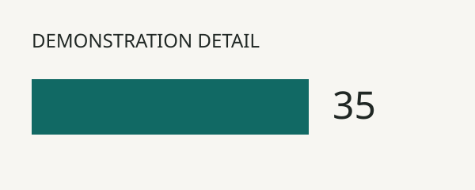

Plain *italic prose* works alongside a [[bibliography example|https://example.org/data|type=bibliography]], a [[default note|Black italic text in braces.]], a [[colored note|The color changes, while the note stays italic.|type=note;color=green]], and a [[colored italic quote|These values are invented.|type=quote;style=italic;color=crimson]].

This example shows how your text and visual appear together. The three bars use **invented numbers**: 20, 35 and 50, from left to right. They are only here to demonstrate the layout.

You can add a [[short note|For a real entry, explain where your numbers came from and what they mean.|💡]] inside a sentence. You can also link to a [[source|https://maind.supsi.ch/master-interaction-design/en]] or give {#116964|a few words} a colour.

Replace this example with your group's own question, evidence and visual. Use the same filenames shown in this folder.

Compare this wide detail  with this [[tall transparent detail|media/example-tall.svg]] inside a sentence. Hover or focus an image to preview it in the background; tap to open and tap again or choose Close media preview to dismiss.

Listen to a [[five-second demonstration tone|media/example-tone.mp3]] or watch the [[generated test pattern|media/example-motion.mp4]] within this sentence. The tone needs Play; the video tries to start muted when visible. Hover the video to enlarge it with sound, then move away to stop the preview. Hover the audio to play it; move away to pause. These are generated demonstrations, not research evidence.

This sentence is wrapped in the source
but continues on the same justified passage.

This sentence starts after a blank line in the source and joins that passage too.
