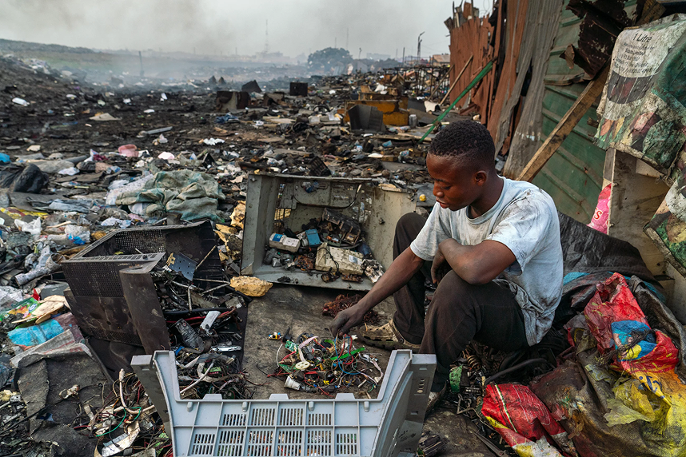
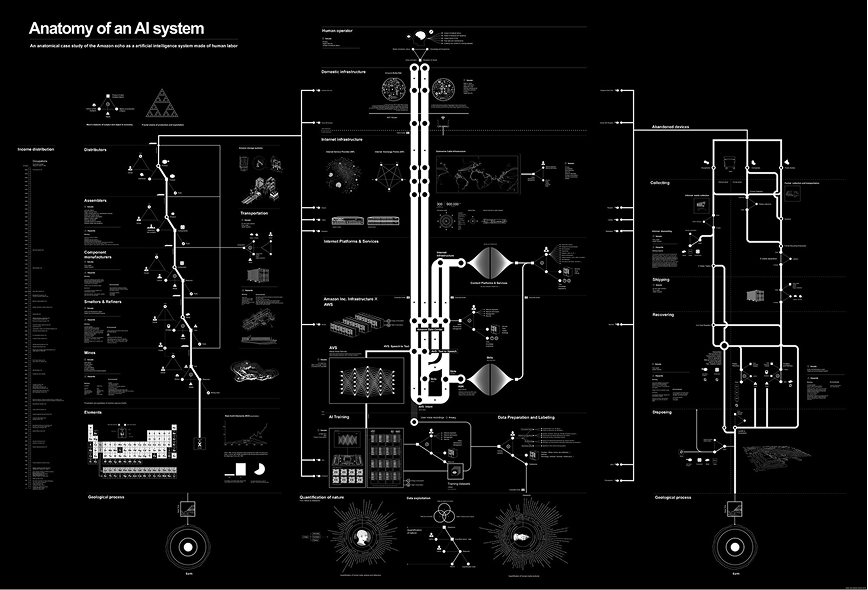
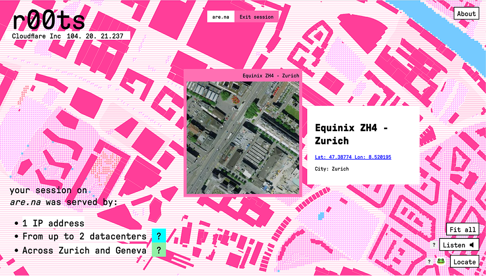
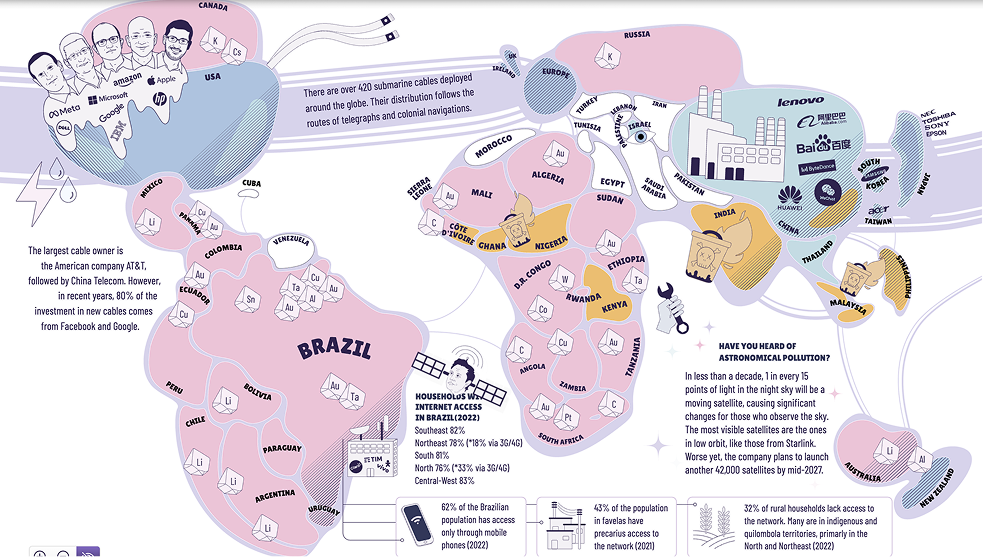
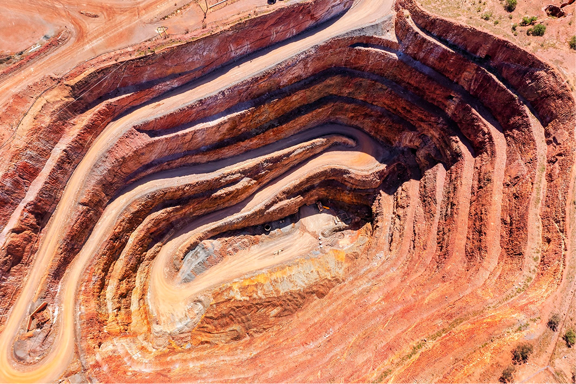
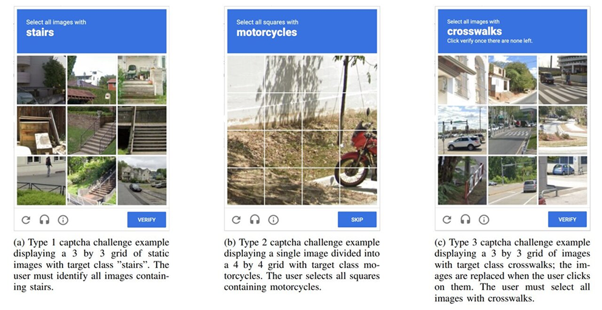
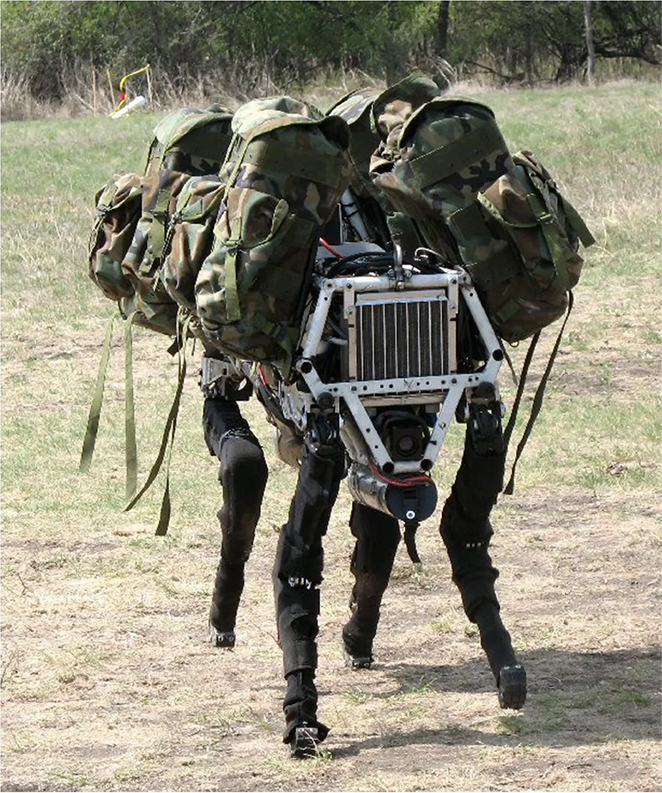

**Digital technologies** are often perceived as immaterial, yet they depend on {#FF09D6|natural resources} , {#0EB5BE|physical infrastructures} , and {#E5B800|human labour}  [[Parikka, 2015|A geology of media|type=bibliography]]. **Artificial intelligence** builds upon these foundations, introducing additional demands through **large-scale computation**, **extensive data processing**, and **increasingly complex models** [[Crawford, 2021|Atlas of AI|type=bibliography]]. These activities consume electricity, require cooling systems that may use substantial amounts of water [[Video 4|media/4.mp4|source=https://www.youtube.com/shorts/smV5wr92v88]], and contribute to environmental impacts [[Audio 5|media/5.mp3|source=https://www.reddit.com/r/Wellthatsucks/comments/1u56euq/sound_emitted_247_from_a_30_megawatt_data_center//]] across **hardware** production , operation, and disposal [[Aczel et al., 2026|Environmental cost of AI’s energy use: Carbon, water and land footprints|type=bibliography]]. Investigating these material dependencies involves two complementary approaches: {underline|revealing} the resources  , infrastructures  and labour behind AI systems, and {underline|tracking}   their material traces across extraction, production, use, and disposal. Both approaches can be applied across {underline|four interconnected dimensions}, each opening different questions about AI’s materialities: {#FF09D6|**1) Geology and ecology** *What does AI extract and consume?*} Minerals , land [[Video 12|media/12.mp4|source=https://petapixel.com/2026/09/19/before-and-after-photos-show-data-centers-furiously-popping-up-across-america/]], energy, and water, with uneven environmental impacts across territories [[Nicoletti et al., 2025|The AI Boom Is Draining Water From the Areas That Need It Most|type=bibliography]]. {#0EB5BE|**2) Infrastructure and computation** *Where and how is AI computation performed?*} **Data centres**, **factories**, **cables**, and **processors** reveal its geographical organisation  [[Coletta et al., 2022|Mapping the clouds: the matter of data centers.|type=bibliography]]. {#8800FF|**3) Human labour** *Whose work makes AI possible?*}  Mining, manufacturing, data annotation  , moderation, maintenance, and disposal sustain automated systems [[Gray & Suri, 2019|Ghost work: How to stop Silicon Valley from building a new global underclass|type=bibliography]]. {#00E279|**4) Embodiment** *How does AI interact with bodies and environments?*} **Sensors**, **cameras** , **wearables**, **robots** , and connected objects embed algorithmic processes into everyday life [[Greenfield, 2017|Radical technologies: The design of everyday life|type=bibliography]]. Each investigation focuses on a specific aspect of AI’s materialities, explored through the collection and analysis of data. {underline|The findings are presented through a data visualisation, accompanied by a multimodal abstract combining different media references to contextualise the topic and expand their interpretation.}
